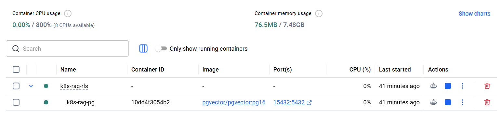
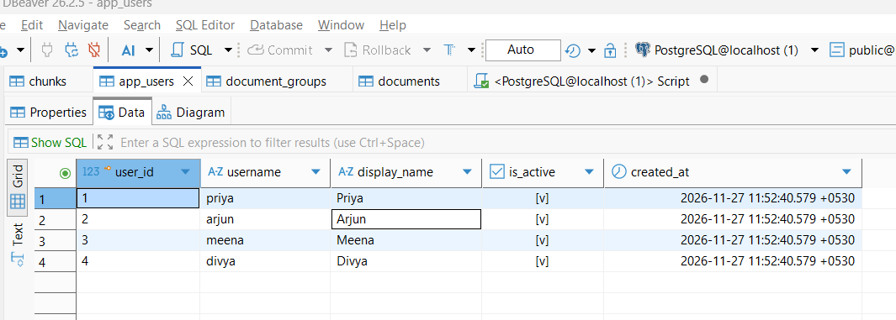
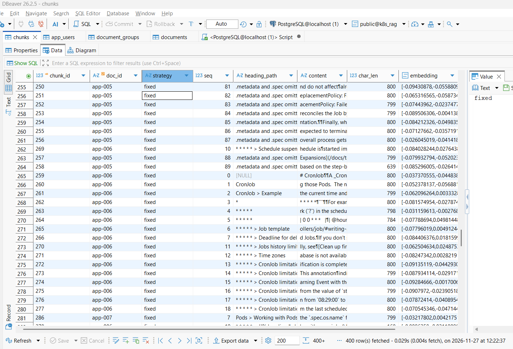
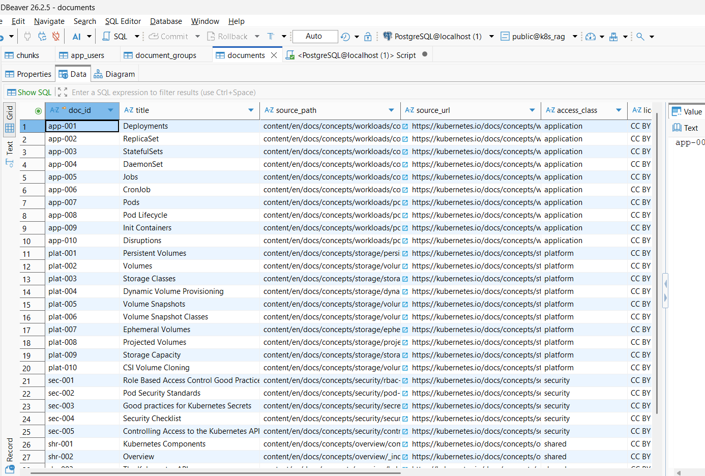

# enterprise-rag-rls-pgvector
### Enterprise RAG: Chunking & Role-Based Security (Kubernetes docs)

Testleaf FDE Program, Week 7 homework. This project:
- ingests 30 official Kubernetes documents
- compares **4 chunking strategies**
- stores **BAAI/bge-small-en-v1.5** (384-dim) embeddings in **PostgreSQL 16 + pgvector**
- enforces department access with **PostgreSQL Row-Level Security (RLS)** inside the retrieval query, before any chunk could reach an LLM

> ### ⚠️ Important: where to install and run
> This code was **authored on a machine where no software was installed** (no PostgreSQL, no pgvector, no Python 3.12, no Docker Desktop).
> **Install, setup and execution are performed on a different Windows machine that already has all required software installed** (see [Prerequisites](#1-prerequisites)).
> Results in `evidence/` are produced on that machine. Fill in the `TODO` cells below after the run.
> **PostgreSQL 16 + pgvector runs in a Docker container** on localhost (`scripts/db_docker.ps1`). A native install is an optional alternative.

> 📚 **Project docs**
> - 📖 [Project story & learning guide](docs/enterprise-rag-rls-pgvector.md): what, why, workflow, sample outputs, takeaways
> - ✅ [Assignment completion checklist](docs/ASSIGNMENT_COMPLETION.md): every requirement with links to evidence
> - 🤖 [AI assistant guide](docs/AI_ASSISTANT_GUIDE.md) (also `.github/copilot-instructions.md`): rules, run order, known issues for VS Code AI tools
> - 🧪 [Test-day checklist](docs/TEST_DAY_CHECKLIST.md) · 🛡️ [Trust boundary](docs/TRUST_BOUNDARY.md) · 🪟 [Windows setup](docs/SETUP_WINDOWS.md) · 📂 [Evidence guide](evidence/README.md) · ⚖️ [LICENSE](LICENSE)

---

## Contents
1. [Prerequisites](#1-prerequisites)
2. [Installation & execution](#2-installation--execution)
3. [Project structure](#3-project-structure)
4. [Dataset & attribution](#4-dataset--attribution)
5. [Chunking comparison & recommendation](#5-chunking-comparison--recommendation)
6. [Embeddings & retrieval](#6-embeddings--retrieval)
7. [Database schema, groups & RLS](#7-database-schema-groups--rls)
8. [Role-by-role retrieval results (Exercise D)](#8-role-by-role-retrieval-results-exercise-d)
9. [Negative access & revocation (Exercise E)](#9-negative-access--revocation-exercise-e)
10. [Logs](#10-logs)
11. [Known limitations & improvements](#11-known-limitations--improvements)
12. [Final reflection](#12-final-reflection)

---

## 1. Prerequisites
These must already be installed on the target Windows machine. The scripts **check** for them but **never install** them.

| Software | Version | How to verify |
|---|---|---|
| Windows 10/11 x64 | – | – |
| Python | **3.12** x64 (with `py` launcher) | `py -3.12 --version` |
| Docker Desktop (WSL2 backend), running | 4.x | `docker info` and `docker compose version` |
| Git | 2.x | `git --version` (optional, `--mode raw` works without it) |
| Network | GitHub + Hugging Face, or a proxy | `python -m src.check_network` |

The first run downloads the model (~130 MB) and CPU PyTorch (~200 MB).

## 2. Installation & execution

### 2.1 Configure credentials
```powershell
git clone <your-repo-url> enterprise-rag-rls-pgvector
cd enterprise-rag-rls-pgvector
Copy-Item .env.example .env
notepad .env    # replace every <...>; optionally PG_PORT, HTTPS_PROXY / HF_ENDPOINT
```
- `.env.example` contains placeholders only and is committed.
- `.env` holds real values and is **git-ignored**. Never commit it.

### 2.2 One command (recommended)
```powershell
powershell -ExecutionPolicy Bypass -File .\scripts\run_all.ps1 -Preflight   # check prerequisites only
powershell -ExecutionPolicy Bypass -File .\scripts\run_all.ps1              # full pipeline
```
Options: `-ResetDb` (rebuild DB), `-SkipFetch`, `-SkipSemantic`, `-RawFetch` (no git).

### 2.3 Step by step
| # | Command | Phase |
|---|---|---|
| 0 | `powershell -ExecutionPolicy Bypass -File .\scripts\setup_venv.ps1 -CpuTorch` | `.venv` + packages |
| – | `.\.venv\Scripts\Activate.ps1` | activate |
| 0 | `python -m src.check_network` | GitHub / HF reachable |
| 1 | `powershell -ExecutionPolicy Bypass -File .\scripts\db_docker.ps1` | Docker container + roles, DB, pgvector, schema, RLS, users (creates if missing, else verifies) |
| 1 | `python -m src.check_setup` | expect `ALL CHECKS PASSED` |
| 2 | `python -m src.fetch_docs` (or `--mode raw`) | 30 docs + manifest |
| 3 | `python -m src.compare_chunking` | 4-strategy comparison |
| 4 | `python -m src.ingest` | embeddings into pgvector |
| 5 | `python -m src.retrieve --user priya --q "..."` | secure retrieval |
| 6 | `python -m src.run_matrix` | Exercise D |
| 7 | `python -m src.negative_tests` | Exercise E |


### 2.4 Database via Docker (default)
PostgreSQL 16 + pgvector runs in a Docker container (`pgvector/pgvector:pg16`), bound to `127.0.0.1:${PG_PORT}` (default 5432).
User names and passwords come from `.env`. No local PostgreSQL install or `psql.exe` is needed, because psql runs inside the container.

```powershell
powershell -ExecutionPolicy Bypass -File .\scripts\db_docker.ps1                 # ensure: create if missing, else verify
powershell -ExecutionPolicy Bypass -File .\scripts\db_docker.ps1 -Action verify   # check only
powershell -ExecutionPolicy Bypass -File .\scripts\db_docker.ps1 -Action status
powershell -ExecutionPolicy Bypass -File .\scripts\db_docker.ps1 -Action stop     # keep data
powershell -ExecutionPolicy Bypass -File .\scripts\db_docker.ps1 -Action reset    # delete volume + rebuild
powershell -ExecutionPolicy Bypass -File .\scripts\db_docker.ps1 -Action psql     # interactive shell
```

What `ensure` does:
1. Starts the container (it is created on the first run, data is kept in volume `k8s-rag-pgdata`) and waits until it is healthy.
2. **Database missing** → runs `sql/00`–`05`: roles, database, pgvector, tables, HNSW index, RLS, grants and demo users.
3. **Database present** → runs `sql/20_verify.sql` (about 20 PASS/FAIL checks: extension, 6 tables, `vector(384)`, HNSW index, RLS, policies, roles, grants, seed data). If any check fails, it re-applies the idempotent scripts and verifies again.
4. Logs to `logs/db_docker.log`.

`scripts/setup_db.ps1` is kept as an **alternative** for a native Windows PostgreSQL install.

### Who creates the database users?
You don't create any users by hand. Fill in the three passwords in `.env` and run `db_docker.ps1`.

| Object | Created by | When |
|---|---|---|
| `postgres` superuser (`PG_SUPERUSER` / `PG_SUPERUSER_PASSWORD`) | Docker image | first container start |
| `ingest_admin` (owns tables, loads data) | `db_docker.ps1` -> `sql/00` | first run |
| `rag_reader` (read-only, NOBYPASSRLS) | `db_docker.ps1` -> `sql/00` | first run |
| `k8s_rag` DB, pgvector, tables, HNSW index, RLS, grants | `db_docker.ps1` -> `sql/01`-`04` | first run |
| Priya, Arjun, Meena, Divya + groups | `db_docker.ps1` -> `sql/05` | first run |

Later runs verify these objects and repair anything missing. They also re-apply the `ingest_admin` and `rag_reader` passwords from `.env`.

**Password rules:**
- Use only letters, digits and `_ - . @`. Avoid `$ # " '` and spaces, which Docker/PowerShell can misread in `.env`.
- The superuser password is fixed when the container volume is first created. If you change it later, run `db_docker.ps1 -Action reset` (this deletes the data).

### Docker Desktop notes (Windows)
- Use Docker Desktop 4.x with the **WSL2 backend** and **Linux containers**. In Settings, check that "Use the WSL 2 based engine" is on.
- Start Docker Desktop and wait for **Engine running** before you run any script.
- The project folder is bind-mounted (`./sql:/sql:ro`). With WSL2 this works for any folder under `C:\Users\...`, so no extra file-sharing setup is needed.
- The port is published on `127.0.0.1` only, so `.env` uses `PG_HOST=127.0.0.1` rather than `localhost`, which avoids IPv6 `::1` issues.
- Behind a corporate proxy, set it in **Docker Desktop → Settings → Resources → Proxies** so `pgvector/pgvector:pg16` can be pulled.
- Works in Windows PowerShell 5.1 and PowerShell 7.

Detailed notes: [`docs/SETUP_WINDOWS.md`](docs/SETUP_WINDOWS.md).
How to capture evidence and screenshots: [`evidence/README.md`](evidence/README.md).
Tick-box run sheet for the target machine: [`docs/TEST_DAY_CHECKLIST.md`](docs/TEST_DAY_CHECKLIST.md).

## 3. Project structure
```
enterprise-rag-rls-pgvector/
├── .env.example            # template (committed)    .env -> real values (git-ignored)
├── requirements.txt        # pinned for Python 3.12
├── docker-compose.yml      # PostgreSQL 16 + pgvector container (localhost only)
├── scripts/                # setup_venv.ps1, db_docker.ps1, run_all.ps1 (setup_db.ps1 = native alternative)
├── sql/                    # 00 roles+db, 01 pgvector, 02 schema, 03 RLS, 04 grants, 05 users, 10 query, 20 verify, 99 reset
├── src/
│   ├── config.py  db.py  log_setup.py  embed.py
│   ├── fetch_docs.py       # Phase 2
│   ├── chunkers.py         # Phase 3: fixed | recursive | markdown | semantic
│   ├── compare_chunking.py # Phase 3 metrics
│   ├── ingest.py           # Phase 4
│   ├── retrieve.py         # Phase 5 (RLS-protected)
│   ├── run_matrix.py       # Phase 6 / Exercise D
│   ├── negative_tests.py   # Phase 7 / Exercise E
│   └── check_setup.py  check_network.py
├── data/                   # raw/, manifest.csv, SOURCES.md
├── evidence/               # generated on run (see evidence/README.md); screenshots/ for PNG + TXT captures
├── logs/                   # app.log, setup_*.log, run_all.log (git-ignored)
├── .github/copilot-instructions.md
├── LICENSE
└── docs/                   # story, completion checklist, AI guide, setup, trust boundary, test-day checklist
```

## 4. Dataset & attribution
- **Source:** official Kubernetes documentation, [github.com/kubernetes/website](https://github.com/kubernetes/website), `content/en/docs/concepts/`. The commit is pinned in `data/SOURCES.md`.
- **License:** [CC BY 4.0](https://creativecommons.org/licenses/by/4.0/), © The Kubernetes Authors. The original filenames, titles, paths and URLs are retained.
- **Access policies are fictional**, created only for this exercise.

| Access group | Source area | Files | doc_id prefix |
|---|---|---|---|
| Application Engineering | `concepts/workloads/` | 10 | `app-` |
| Platform Engineering | `concepts/storage/` | 10 | `plat-` |
| Security Engineering | `concepts/security/` | 5 | `sec-` |
| Shared knowledge | `concepts/overview/` | 5 | `shr-` |

The full file list with URLs is in [`data/SOURCES.md`](data/SOURCES.md) and `data/manifest.csv`. Paste the table here after running `fetch_docs`.

## 5. Chunking comparison & recommendation
All 4 strategies run on the **same 30 cleaned documents**. Cleaning removes front matter, comments and layout shortcodes, and adds the title as H1. All strategies use the same size budget.

| Strategy | Approach | Params |
|---|---|---|
| fixed | character windows | 800 / overlap 100 |
| recursive | `\n## ` → `\n### ` → paragraph → line → sentence → word | 800 / overlap 100 |
| markdown | split on H1–H3, keep heading path, recursive inside long sections, merge tiny fragments | 800 / 0, min 120 |
| semantic | sentence embeddings (bge-small), break at 85th-percentile neighbour distance | min 120, cap 1200 |

**Results:** copy from `evidence/chunking_comparison.md`.

| strategy | chunks | avg | min | median | max | overlap avg | heading preserved % | starts at heading % | clean end % | mid-word cut % | split code % | tiny % |
|---|---|---|---|---|---|---|---|---|---|---|---|---|
| fixed | 807 | 786 | 115 | 800 | 800 | 99 | 96.3% | 4.3% | 7.2% | 85.4% | 11.0% | 0.2% |
| recursive | 1035 | 547 | 3 | 600 | 800 | 11 | 97.1% | 44.0% | 87.2% | 0.5% | 2.1% | 3.5% |
| markdown | 933 | 588 | 17 | 713 | 802 | 110 | 100.0% | 50.1% | 69.3% | 16.5% | 7.3% | 3.0% |
| semantic | 807 | 686 | 87 | 634 | 5889 | 0 | 61.8% | 20.2% | 79.1% | 28.7% | 4.7% | 0.6% |

Good and poor boundary examples: [`evidence/chunking_examples.md`](evidence/chunking_examples.md).

**Recommendation: Markdown structure-aware chunking** (confirm against the table):
- Kubernetes docs are already organised by H2/H3 sections, so each section answers one concept.
- Each chunk keeps its heading path (e.g. `Deployments > Scaling a Deployment`), which gives precise attribution and better retrieval context.
- It shouldn't cut mid-word or split code blocks, which the fixed strategy does by design.
- It is deterministic and cheap compared with semantic chunking, which needs an extra embedding pass and produces more variable sizes.
- Recursive chunking is a close second and is the fallback for non-Markdown sources.

`RETRIEVAL_STRATEGY=markdown` in `.env`. All 4 strategies are stored (`chunks.strategy`), so they can be compared without re-ingesting.

## 6. Embeddings & retrieval
- **Model:** `BAAI/bge-small-en-v1.5`, 384 dimensions, L2-normalised. Queries use the bge prefix `Represent this sentence for searching relevant passages: `.
- **Storage:** `rag.chunks.embedding vector(384)` with an **HNSW** index using `vector_cosine_ops`.
- **Traceability:** each chunk has `doc_id`, `strategy`, `seq`, `heading_path`, `content` and `char_len`. These join to `documents` (`title`, `source_path`, `source_url`, `access_class`, `license`, `sha256`).
- **Query** (`src/retrieve.py`, also [`sql/10_retrieval_query.sql`](sql/10_retrieval_query.sql)):
```sql
SELECT c.doc_id, d.title, c.heading_path, c.seq, d.access_class, d.source_url,
       c.embedding <=> :q AS cosine_distance, c.content
FROM rag.chunks c JOIN rag.documents d USING (doc_id)
WHERE c.strategy = :strategy
ORDER BY c.embedding <=> :q
LIMIT :k;      -- executed as rag_reader -> RLS filters rows
```

## 7. Database schema, groups & RLS
```
groups(group_id, group_key, display_name)
app_users(user_id, username, display_name, is_active)
user_groups(user_id → app_users, group_id → groups)            -- membership (revocable)
documents(doc_id, title, source_path, source_url, access_class, license, sha256, char_len)
document_groups(doc_id → documents, group_id → groups)         -- permission
chunks(chunk_id, doc_id → documents, strategy, seq, heading_path, content, char_len, embedding vector(384))
```

**Memberships** (`sql/05_seed_users.sql`):

| Employee | Groups | May retrieve |
|---|---|---|
| Priya | application, shared | Application + shared |
| Arjun | platform, shared | Platform + shared |
| Meena | security, shared | Security + shared |
| Divya | application, security, shared | Both departments + shared |

**Roles** (least privilege):

| Role | Purpose | Privileges |
|---|---|---|
| `postgres` | setup only (`db_docker.ps1`) | superuser. **Never used by Python** |
| `ingest_admin` | trusted ingestion job | owns schema `rag`, writes data |
| `rag_reader` | retrieval path | `SELECT` on `documents` and `chunks` only, `NOBYPASSRLS`, no access to membership tables, no writes |

**RLS policy** (`sql/03_rls.sql`):
```sql
ALTER TABLE rag.chunks ENABLE ROW LEVEL SECURITY;
CREATE POLICY chunks_read_by_group ON rag.chunks FOR SELECT TO rag_reader
  USING (rag.can_read_doc(doc_id));
-- can_read_doc(): SECURITY DEFINER; true only if current_setting('app.current_user')
-- is an ACTIVE user in a group linked to the document via document_groups.
```
- Identity is set per transaction: `set_config('app.current_user', <user>, true)`.
- An unknown or empty identity matches nothing, so it gets **0 rows**.
- Revocation is `DELETE FROM user_groups`. It takes effect on the next query with **no re-embedding**.

**Trust boundary:** enforcement happens **inside PostgreSQL in the retrieval query**. Unauthorised chunks are never ranked, returned to Python, or sent to an LLM. No label check or post-retrieval filter is used. The `--user` flag **simulates** a verified identity for this local demo only. In production, a trusted backend sets it from a verified OIDC/JWT token and users never hold database credentials. Full explanation: [`docs/TRUST_BOUNDARY.md`](docs/TRUST_BOUNDARY.md).

## 8. Role-by-role retrieval results (Exercise D)
Generated by `python -m src.run_matrix`. Full tables with doc IDs, source links, cosine distances, an `authorised` column and "hidden by RLS" lists are in [`evidence/matrix.md`](evidence/matrix.md).

| Question | Area | priya | arjun | meena | divya | nobody |
|---|---|---|---|---|---|---|
| Q1 How does a Kubernetes Deployment manage application replicas? | application | `app-002` / 0.1569 | `shr-004` / 0.2000 | `shr-004` / 0.2000 | `app-002` / 0.1569 | 0 rows |
| Q2 What are PersistentVolumes and PersistentVolumeClaims? | platform | `app-003` / 0.2051 | `plat-001` / 0.2064 | `sec-001` / 0.1893 | `sec-001` / 0.1893 | 0 rows |
| Q3 What are recommended Kubernetes RBAC practices? | security | `shr-002` / 0.2481 | `shr-002` / 0.2481 | `sec-001` / 0.1612 | `sec-001` / 0.1612 | 0 rows |
| Q4 What are the main Kubernetes components? | shared | `shr-001` / 0.1299 | `shr-001` / 0.1299 | `shr-001` / 0.1299 | `shr-001` / 0.1299 | 0 rows |

Expected pattern: each user's top hits come only from their own groups plus shared. The script exits with code 1 if any unauthorised chunk appears. **Result: PASS (0 unauthorised results).** Screenshot: `evidence/screenshots/05_run_matrix.png`.

## 9. Negative access & revocation (Exercise E)
Generated by `python -m src.negative_tests`. Log: [`evidence/negative_tests.md`](evidence/negative_tests.md). Screenshot: `evidence/screenshots/06_negative_tests.png`, captured with `.\scripts\capture_evidence.ps1 -Name 06_negative_tests -Command "python -m src.negative_tests"`.

| Test | Requirement | Result |
|---|---|---|
| T1 | Authorised user (Meena) retrieves a restricted security document | PASS (4 chunks of `sec-001` returned) |
| T2 | Unauthorised user (Priya) cannot retrieve it (ranked search **and** direct `SELECT count`) | PASS (0 ranked hits, 0 direct `SELECT` rows) |
| T3 | Revoking Meena's `security` membership removes access immediately. Chunk IDs and embedding checksum are unchanged, so there was **no re-embedding or re-ingest** | PASS (visible=0, 26 chunks `2582-2607` md5 `df388b9c422f` unchanged) |
| T4 | Unknown (`mallory`) and empty identities read 0 protected chunks | PASS (0 ranked hits, 0 `SELECT count(*)` for both) |
| T5 | Restoring the membership returns access | PASS (4 chunks of `sec-001` restored) |
| T6 | Extra: reader cannot UPDATE chunks, read `user_groups`, or grant itself membership | PASS (all 3 denied with `permission denied`) |

## 10. Logs
- Every Python command writes timestamped lines to `logs/app.log`, for example `2026-11-26 19:44:01 | ingest | INFO | ...`. The log rotates at 5 MB and passwords are masked.
- PowerShell scripts write transcripts to `logs/setup_venv.log`, `logs/setup_db.log` and `logs/run_all.log`.
- `logs/` is git-ignored. Copy relevant extracts into `evidence/` if needed.

## 11. Known limitations & improvements
| Limitation | Improvement |
|---|---|
| `--user` simulates identity; anyone with the `rag_reader` password could set any name | trusted API layer with OIDC/JWT; sign the identity claim and verify it in the DB; secrets in a vault |
| A single shared reader role | per-tenant roles, or `SET ROLE` to per-user database roles |
| The HNSW index scans before RLS filters, so a restricted-heavy top-k can return fewer than k rows | raise `hnsw.ef_search` (already 100), use pgvector 0.8 iterative index scans, or exact scan at this data size |
| `can_read_doc()` is evaluated per row | denormalise `group_ids smallint[]` onto chunks with a GIN index, or partition by access class |
| Document-level permissions only | section-level or chunk-level labels, and attribute-based policies (ABAC) |
| No answer generation / LLM step | add an LLM only after RLS retrieval, with citations from `source_url` and `heading_path` |
| Semantic chunking threshold is global (85th percentile) | tune per document; evaluate with labelled queries (recall@k, MRR) |
| No retrieval-quality evaluation set | build a small gold set and compare strategies with recall@k |
| Audit owner view in `run_matrix` uses the owner connection | separate read-only auditor role with `BYPASSRLS`, logged access |
| Container password via env vars | Docker secrets / vault; TLS on the connection |

## 12. Final reflection

**Q1. Is semantic chunking always better than recursive or structure-aware chunking?**
No. For technical documentation that already has a clear heading structure, structure-aware chunking usually wins:
- It keeps the author's section boundaries and heading paths, which are useful for attribution and as retrieval context.
- It is deterministic, and it is cheap because it needs no extra embedding pass.
- It doesn't split code blocks.

Semantic chunking depends on a similarity threshold. It produces more variable chunk sizes and can split inside lists or code, where neighbouring sentences look dissimilar. It is most useful for long unstructured prose.
*Evidence:* `evidence/chunking_comparison.md`. Markdown vs semantic: heading preserved **100.0%** vs **61.8%**, size stdev **223** vs **454** (max **802** vs **5889**), split-code **7.3%** vs **4.7%**, and runtime **0.1s** vs **327.7s**.

**Q2. If the most semantically relevant document is restricted, what should the retriever return?**
- Only the best **authorised** chunks, ranked normally. The restricted document must not be returned, summarised, or hinted at. Its title, snippet and existence should not be revealed.
- If nothing authorised is relevant enough (e.g. distance above a threshold), return "no authorised results" and suggest the normal access-request process, without confirming that a hidden document exists.
- This is what RLS produces here. See the "Hidden by RLS" lines in `evidence/matrix.md`, for example Priya on Q3.

**Q3. Why must permissions be enforced by the retrieval system instead of asking an LLM to respect them?**
- Once a chunk is in the prompt, it has already been disclosed. An LLM is non-deterministic, has no reliable concept of identity, and can be bypassed through prompt injection, jailbreaks, summarisation leakage, or logs and traces that capture the context.
- Database enforcement is deterministic, auditable and testable (Exercise E). It applies to every client, not only the chatbot.
- Revocation takes effect immediately in the data path (T3), with no prompt change or re-embedding.
- The LLM should only ever receive data the user is already authorised to read.

## 13. Conclusion & Key Takeaways
This project demonstrates that **enterprise RAG security belongs in the data layer, not the prompt layer**:
- **Structure-aware chunking wins for technical docs:** Markdown chunking preserved **100%** of heading paths in **0.1s** (vs **61.8%** and **327.7s** for semantic chunking), giving clean attribution and predictable chunk sizes without an extra embedding pass.
- **Database-enforced RLS is deterministic and instant:** Enforcing `can_read_doc(doc_id)` inside PostgreSQL as `rag_reader` (`NOBYPASSRLS`) guarantees **0 unauthorised results** across all 20 matrix queries and **9/9 passing negative tests**.
- **Zero-re-embedding revocation:** Membership changes in `rag.user_groups` take effect on the very next query while keeping all vector embeddings and chunk IDs untouched.
- **Least privilege matters:** Separating `postgres` (setup), `ingest_admin` (batch ingestion), and `rag_reader` (`SELECT`-only on `documents` and `chunks`) ensures the retrieval path cannot tamper with data or group memberships.

## 14. Evidence & Screenshots

| # | Evidence | File Link | Screenshot |
|---|---|---|---|
| 1 | PostgreSQL 16 + pgvector Docker container | [`1_docker_container.png`](evidence/screenshots/1_docker_container.png) |  |
| 2 | Seeded users & group memberships | [`2_UserTable.png`](evidence/screenshots/2_UserTable.png) |  |
| 3 | Chunking data & embeddings | [`3_chunkingdata.png`](evidence/screenshots/3_chunkingdata.png) |  |
| 4 | Documents table & access classes | [`4_documentstable.png`](evidence/screenshots/4_documentstable.png) |  |

---
**Do not commit** `.env`, passwords, API keys or real credentials. Only `.env.example` contains placeholders.

*Engineer the retrieval. Enforce the access. Prove the result.*
