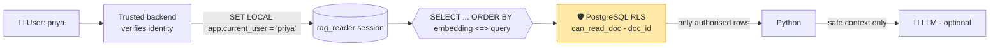
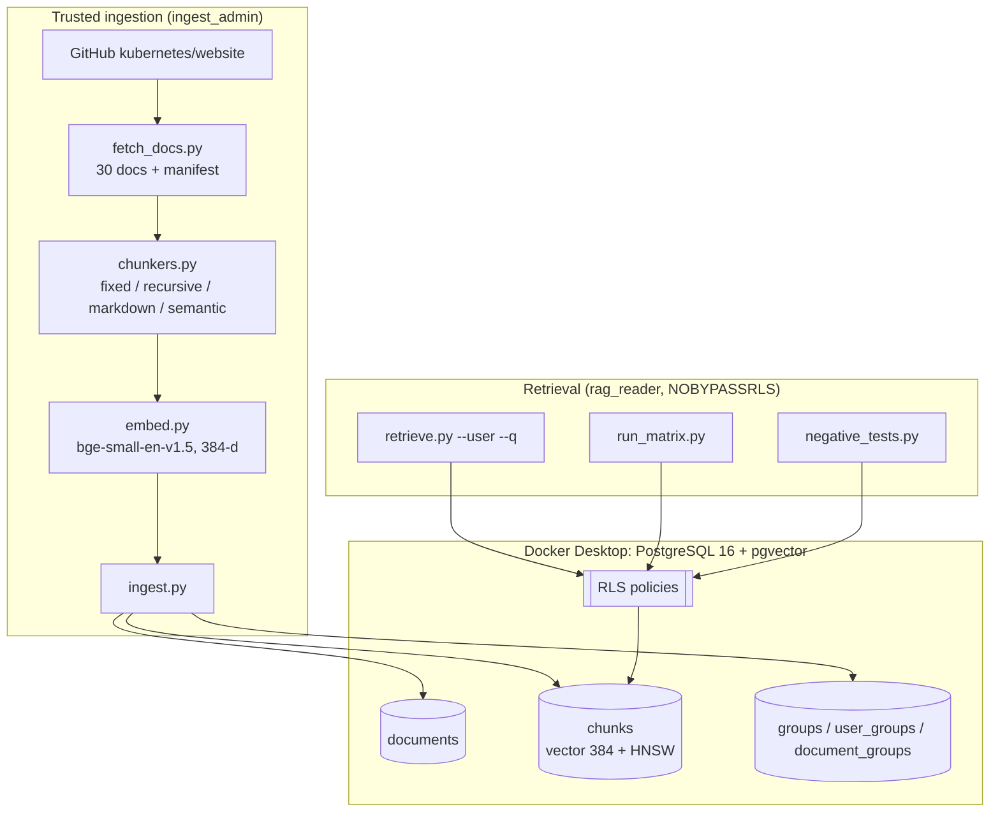
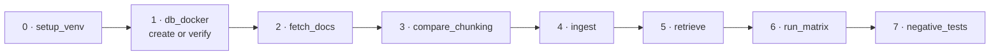

# 🔐 enterprise-rag-rls-pgvector
### Engineer the retrieval. Enforce the access. Prove the result.

     

---

## 📌 Summary
A hands-on project that builds the **retrieval layer of an enterprise knowledge assistant** that respects who is asking.

We take 30 real Kubernetes documentation pages and split them four different ways to see which chunking works best. We store them as vector embeddings in PostgreSQL with pgvector, and lock them down with **Row-Level Security (RLS)**, so an engineer only ever retrieves what their department is allowed to see. Then we **prove it** with a test matrix, negative tests and live revocation.

---

## 📖 Description: the story

### The problem
*Northwind Tech* (a fictional company) has three engineering departments:

| Department | Owns |
|---|---|
| 🧩 Application Engineering | Deployments, Pods, Jobs (workloads) |
| 🗄️ Platform Engineering | Volumes, PersistentVolumes, StorageClasses |
| 🛡️ Security Engineering | RBAC, Pod Security, Secrets practices |
| 🌐 Everyone | Kubernetes overview and components |

Leadership wants one AI assistant for all of them. The security team has one non-negotiable rule:

> *"If Priya from Application Engineering asks about RBAC, the assistant must not even **see** the security team's restricted documents, let alone quote them."*

### Why this is hard
A naive RAG system retrieves the top-k most similar chunks and then asks the LLM to "please ignore what the user shouldn't see". That fails because:
- Once a chunk is in the prompt, it **has already leaked**.
- LLMs can be **prompt-injected** into revealing context.
- Filtering in application code is easy to forget in one code path.

### Our approach
Move the security boundary **into the database query itself**:



PostgreSQL removes unauthorised rows **before** they are ranked or returned. Python, and any LLM, only ever see data the user is allowed to read.

### Use case examples
| Who | Asks | Gets |
|---|---|---|
| **Priya** (Application) | "How does a Deployment manage replicas?" | ✅ Deployment and ReplicaSet docs |
| **Priya** (Application) | "What are recommended RBAC practices?" | ✅ Shared overview docs only. ❌ No security docs. Nothing reveals they exist. |
| **Meena** (Security) | "What are recommended RBAC practices?" | ✅ RBAC good practices doc |
| **Divya** (Application + Security) | either question | ✅ both departments + shared |
| **Unknown user** | anything | ❌ 0 rows |
| **Meena after revocation** | "RBAC practices?" | ❌ access gone instantly, **no re-embedding** |

---

## 🏗️ Architecture



| Role | Can do | Used by |
|---|---|---|
| `postgres` | everything | container setup only |
| `ingest_admin` | own tables, write data | `ingest.py` |
| `rag_reader` | `SELECT` documents/chunks, **always filtered by RLS** | `retrieve.py` |

---

## ⚙️ Code execution workflow

> **Prerequisites (already installed on the run machine):** Windows 10/11, Python 3.12, Docker Desktop (WSL2, running), Git.



### Step by step
```powershell
# 0. Configure
git clone <repo-url> enterprise-rag-rls-pgvector
cd enterprise-rag-rls-pgvector
Copy-Item .env.example .env          # set 3 passwords (letters, digits, _ - . @)

# 1. Check prerequisites, then run everything
powershell -ExecutionPolicy Bypass -File .\scripts\run_all.ps1 -Preflight
powershell -ExecutionPolicy Bypass -File .\scripts\run_all.ps1
```

| Phase | Command | What happens |
|---|---|---|
| 0 | `scripts\setup_venv.ps1` | creates `.venv` and installs pinned packages |
| 1 | `scripts\db_docker.ps1` | starts the container; creates roles, DB, tables, RLS and users **if missing**, otherwise **verifies** about 20 checks |
| 2 | `python -m src.fetch_docs` | sparse-clones 30 docs; writes `manifest.csv` and `SOURCES.md` |
| 3 | `python -m src.compare_chunking` | runs 4 strategies; writes the metrics table and examples |
| 4 | `python -m src.ingest` | embeds chunks and stores them with permissions |
| 5 | `python -m src.retrieve --user priya --q "..."` | RLS-protected semantic search |
| 6 | `python -m src.run_matrix` | 4 questions × 5 identities |
| 7 | `python -m src.negative_tests` | deny, revoke, restore |

All output is logged with timestamps to `logs/app.log`. Evidence goes to `evidence/`.

---

## 📊 Output samples – the 4 test questions

> ⚠️ **Illustrative, expected pattern.** The values below show the *shape* of the output and the expected access pattern.
> Doc IDs depend on the files selected, and cosine distances (`0.xx`) depend on the actual run.
> **Real results are in [`evidence/matrix.md`](../evidence/matrix.md)** after running `python -m src.run_matrix`.

### Q1 · "How does a Kubernetes Deployment manage application replicas?" (Application)
```text
user=priya  strategy=markdown  k=5
| # | doc_id  | access      | cos_dist | heading                                  | authorised |
|---|---------|-------------|----------|------------------------------------------|------------|
| 1 | app-001 | application | 0.1x     | Deployments > Scaling a Deployment       | YES        |
| 2 | app-002 | application | 0.2x     | ReplicaSet > How a ReplicaSet works      | YES        |
| 3 | app-001 | application | 0.2x     | Deployments > Rolling Update Deployment  | YES        |
| 4 | shr-001 | shared      | 0.3x     | Kubernetes Components > Control Plane    | YES        |

user=arjun (platform): only plat-* / shr-* results -> app-* listed under "Hidden by RLS"
```

### Q2 · "What are PersistentVolumes and PersistentVolumeClaims?" (Platform)
```text
user=arjun   -> plat-001 Persistent Volumes > Introduction            0.1x  YES
               plat-001 Persistent Volumes > Lifecycle of a volume     0.2x  YES
               plat-00x Storage Classes                                0.2x  YES
user=priya   -> app-* / shr-* only           Hidden by RLS: plat-001, plat-00x
user=nobody  -> No authorised results (0 rows returned by RLS).
```

### Q3 · "What are recommended Kubernetes RBAC practices?" (Security)
```text
user=meena   -> sec-001 Role Based Access Control Good Practices > Least privilege  0.1x  YES
user=divya   -> sec-001 ... (same as meena, plus app-* / shr-* if relevant)          YES
user=priya   -> shr-* / app-* only           Hidden by RLS: sec-001, sec-00x
user=arjun   -> shr-* / plat-* only          Hidden by RLS: sec-001, sec-00x
```

### Q4 · "What are the main Kubernetes components?" (Shared)
```text
user=priya|arjun|meena|divya -> shr-001 Kubernetes Components > Control Plane Components  0.1x  YES
user=nobody                  -> 0 rows

Result: PASS - 0 unauthorised chunk(s) returned across 4 questions x 5 identities.
```

### Exercise E · negative tests (illustrative)
```text
[PASS] T1 authorised access - meena received N chunk(s) of sec-001
[PASS] T2 unauthorised denied - priya ranked hits on sec-001=0, direct SELECT count=0
    SQL: revoke meena -> security  (1 row(s) changed, committed)
[PASS] T3 revocation immediate - visible=0, embeddings unchanged=True
[PASS] T4 identity 'mallory' - ranked hits=0, SELECT count(*) on all chunks=0
[PASS] T4 identity '<empty>' - ranked hits=0, SELECT count(*) on all chunks=0
    SQL: restore meena -> security  (1 row(s) changed, committed)
[PASS] T5 access restored - meena received N chunk(s) of sec-001
[PASS] T6 UPDATE chunks - permission denied for table chunks
[PASS] T6 SELECT user_groups - permission denied for table user_groups
[PASS] T6 change own membership - permission denied for table user_groups
## Summary: 9/9 passed
```

### Chunking comparison (shape only)
| strategy | chunks | avg | heading preserved % | mid-word cut % | split code % |
|---|---|---|---|---|---|
| fixed | … | ~800 | low | high | high |
| recursive | … | <800 | medium | ~0 | low |
| markdown | … | varies | **~100** | ~0 | ~0 |
| semantic | … | most variable | low–medium | ~0 | possible |

Real numbers: [`evidence/chunking_comparison.md`](../evidence/chunking_comparison.md).

---

## 🎓 What we learn
1. **Chunking is a design decision, not a default.** The same 30 docs give very different chunk counts, sizes and boundary quality depending on the strategy.
2. **Structure beats cleverness for technical docs.** Markdown-aware chunking keeps headings such as `Deployments > Scaling`, which helps both retrieval and citations.
3. **Embeddings need small details right:** bge's query-only prefix, normalised vectors, and cosine distance (`<=>`) with an HNSW index.
4. **RLS turns authorisation into data.** Access is a row in `user_groups`, so revoking access is a `DELETE`, not a re-index.
5. **Least privilege is concrete:** separate owner and reader roles, `NOBYPASSRLS`, no access to membership tables, and transaction-local identity.
6. **Security must be tested, not trusted.** The matrix and negative tests turn "it should be secure" into evidence.
7. **Operational hygiene matters:** idempotent SQL, a container health check, `.env` secrets, logs, and reproducible scripts.

---

## 🔑 Key takeaways
> - 🛡️ **Enforce permissions where the data lives**, in the retrieval query, never in the prompt.
> - 🚫 **The LLM is not a security boundary.** If it never receives the chunk, it can't leak it.
> - ⚡ **Revocation should be instant:** with RLS it is a single `DELETE`, with no re-embedding.
> - 🧱 **Markdown structure-aware chunking** is a strong default for technical docs. Check it against the measured comparison.
> - 🔍 **Return only the best *authorised* results**, and never hint that a hidden document exists.
> - ✅ **Prove it:** same question, different users, different results, with 0 unauthorised rows.

---

## 🏁 Conclusion
We built a small but production-shaped secure RAG retrieval layer:
- **real data** (Kubernetes docs, CC BY 4.0)
- **measured chunking choices** (4 strategies)
- **semantic search** (bge-small + pgvector HNSW)
- **database-enforced access control** (PostgreSQL RLS with least-privilege roles)

It is wrapped in reproducible tooling: Docker Desktop, PowerShell scripts, logs and evidence.

The key idea carries over to any enterprise AI system. **Engineer the retrieval, enforce the access in the data layer, and prove the result with tests.** Adding an LLM on top is then the easy part, because it can only ever see what the user was already allowed to read.

**Where to go next:** a trusted API with OIDC/JWT identity, chunk-level labels, iterative HNSW scans (pgvector 0.8), a retrieval-quality evaluation set (recall@k), and an LLM answer step with citations.

📚 More: [README](../README.md) · [Trust boundary](TRUST_BOUNDARY.md) · [Setup](SETUP_WINDOWS.md) · [Checklist](ASSIGNMENT_COMPLETION.md)

---

<p align="center"><b>Happy Learning !!!!!, with <a href="https://www.DoLearnSomething.com">www.DoLearnSomething.com</a></b></p>
